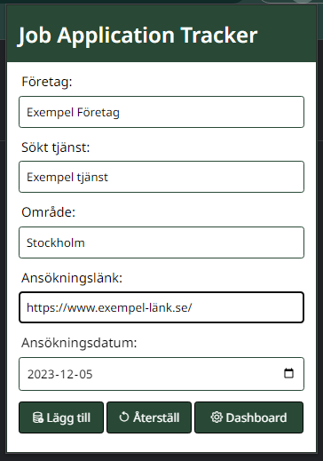
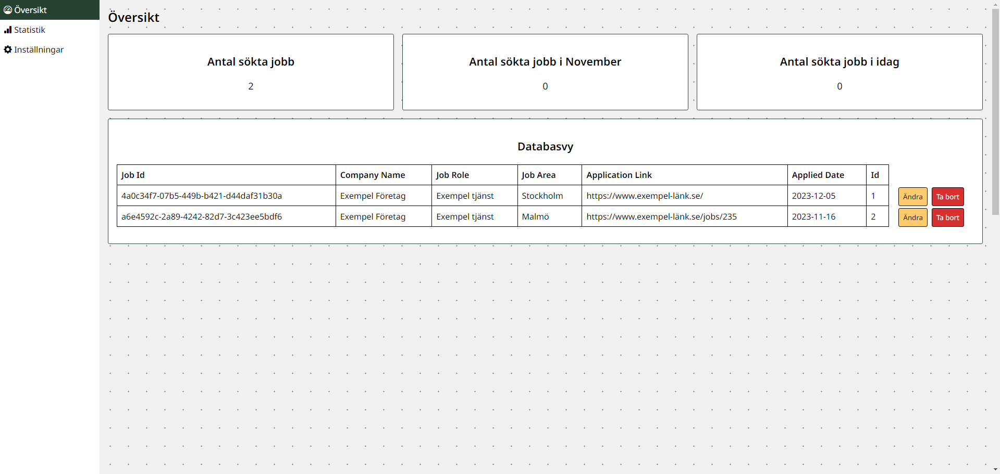
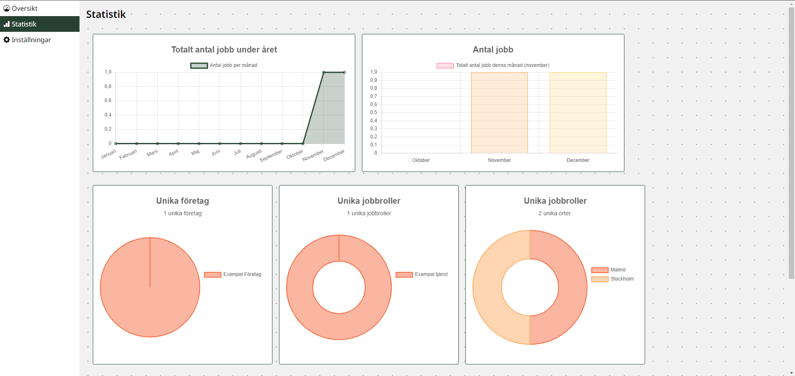

# J.A.T (Job Application Tracker)

J.A.T is a browser extension(only chrome for now.) that helps you keep track of the jobs that you apply for.

J.A.T also have integration with Arbetsförmedlingen's website and allows the extension to automate the process of reporting your activites(**Aktivitetsrapportering**)

J.A.T uses IndexDB to store your job applications locally on your machine which means no personal data will be sent to any type of server.

> [!WARNING]
> Do keep mind because IndexDB is being used as a database, it can be easily erased by the user by clearing your cache in your web browser (Same as clearing your cookies.)

# Installation Steps:
1. Clone the repo.
2. Run ```npm install``` and then ```npm run build``` while in the root directory.
3. Open Google Chrome and navigate to chrome://extensions.
4. Turn on developer mode, click on 'Load unpacked', navigate to the cloned repo folder and select the 'dist/chrome-mv3' folder.
5. You should now have J.A.T installed in your web browser, simply click the boat icon the upper right corner and start inputting the details of your job application.

# Development
J.A.T is built with [WXT](https://wxt.dev/).
- ```npm run dev``` starts a browser with the extension loaded and reloads it when files change (```npm run dev:firefox``` for Firefox).
- ```npm run build``` builds for Chrome into `dist/chrome-mv3`, ```npm run build:firefox``` builds for Firefox into `dist/firefox-mv2`.
- ```npm run zip``` / ```npm run zip:firefox``` package the extension for the web stores.
- ```npm run compile``` type-checks the code.

Pages live in `src/entrypoints/`, shared code in `src/utils/` and static files (icons) in `public/`. The manifest is generated from `wxt.config.ts`.

# Libraries used
-  [React](https://react.dev/), [Tailwind CSS](https://tailwindcss.com/) and [shadcn/ui](https://ui.shadcn.com/) for the UI.
-  [Chart.JS](https://www.chartjs.org/) for charts & diagrams.
-  [idb](https://www.npmjs.com/package/idb) for interfacing with IndexDB & TypeScript Support


# Screenshots
### Popup


### Dashboard / Overview


### Statistics

