# J.A.T (Job Application Tracker)

[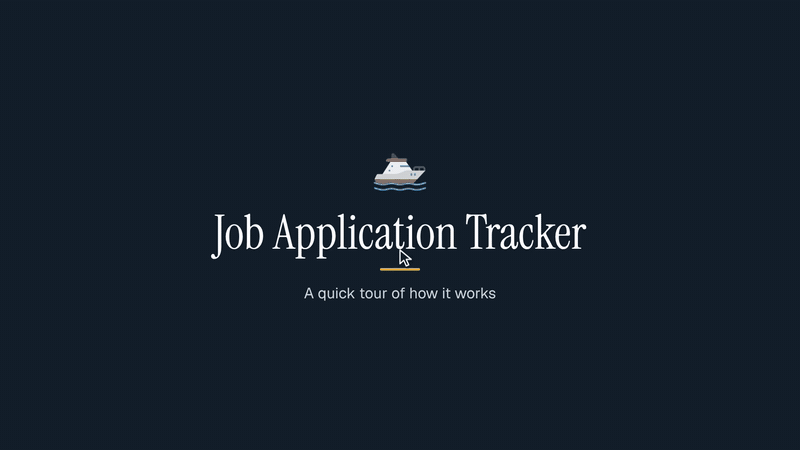](screenshots/tour.mp4)

_[Watch the tour as an MP4 video](screenshots/tour.mp4)._

J.A.T is a browser extension for Chrome (and other Chromium-based browsers, such as Edge and Brave) and Firefox that helps you keep track of the jobs that you apply for.

J.A.T also integrates with Arbetsförmedlingen's website: it fills in the **Sökta jobb** form of your activity report (**Aktivitetsrapportering**) with the applications you have saved. See [Reporting to Arbetsförmedlingen](#reporting-to-arbetsförmedlingen).

J.A.T uses IndexDB to store your job applications locally on your machine which means no personal data will be sent to any type of server.

# Installation Steps:

1. Clone the repo.
2. Run `npm install` in the root directory.
3. Build and load the extension for your browser:

### Chrome and other Chromium-based browsers

1. Run `npm run build`.
2. Open chrome://extensions (edge://extensions in Edge, brave://extensions in Brave).
3. Turn on developer mode, click on 'Load unpacked', navigate to the cloned repo folder and select the 'dist/chrome-mv3' folder.

### Firefox

1. Run `npm run build:firefox`.
2. Open about:debugging#/runtime/this-firefox.
3. Click on 'Load Temporary Add-on…', navigate to the cloned repo folder and select the 'manifest.json' file in the 'dist/firefox-mv2' folder.

# Reporting to Arbetsförmedlingen

When you open the **Sökta jobb** form on Mina sidor (_Aktivitetsrapportera → Lägg till aktivitet_), a J.A.T panel appears next to it.

1. The panel lists the applications you saved in the month you are reporting, with the ones you haven't reported yet first.
2. Pick an application to see a preview of what will be filled in. You can change the values here before filling. The changes only apply to this report, not to your saved application.
    - **Var finns jobbet?** defaults to _Sverige_ and **Svarade du på en annons?** defaults to _Ja_.
    - The panel warns you if the application has no employment type, or if its date falls outside the reported month.
3. Click **Fyll i formuläret**. J.A.T fills in the form and shows which fields were filled.
4. Review the form and click **Spara** yourself. J.A.T never submits the form for you.

> [!NOTE]
> J.A.T reads its data in your browser and only fills in the form on your screen. Nothing is sent to Arbetsförmedlingen until you click **Spara** yourself.

# Development

J.A.T is built with [WXT](https://wxt.dev/).

- `npm run dev` starts a browser with the extension loaded and reloads it when files change (`npm run dev:firefox` for Firefox).
- `npm run build` builds for Chrome into `dist/chrome-mv3`, `npm run build:firefox` builds for Firefox into `dist/firefox-mv2`.
- `npm run zip` / `npm run zip:firefox` package the extension for the web stores.
- `npm run compile` type-checks the code.

# Libraries used

- [WXT](https://wxt.dev/) to build the extension for Chrome and Firefox from one codebase.
- [React](https://react.dev/) and [Tailwind CSS](https://tailwindcss.com/) for the UI.
- [shadcn/ui](https://ui.shadcn.com/) components, built on [Radix UI](https://www.radix-ui.com/) (dialogs, popovers and labels).
- [Lucide](https://lucide.dev/) for icons and [Sonner](https://sonner.emilkowal.ski/) for notifications.
- [idb](https://www.npmjs.com/package/idb) for interfacing with IndexedDB, with TypeScript support.
- [Fontsource](https://fontsource.org/) for the Geist, Geist Mono and Instrument Serif fonts.
- [web-ext](https://github.com/mozilla/web-ext) for linting and running the Firefox build.

# Screenshots

### Popup

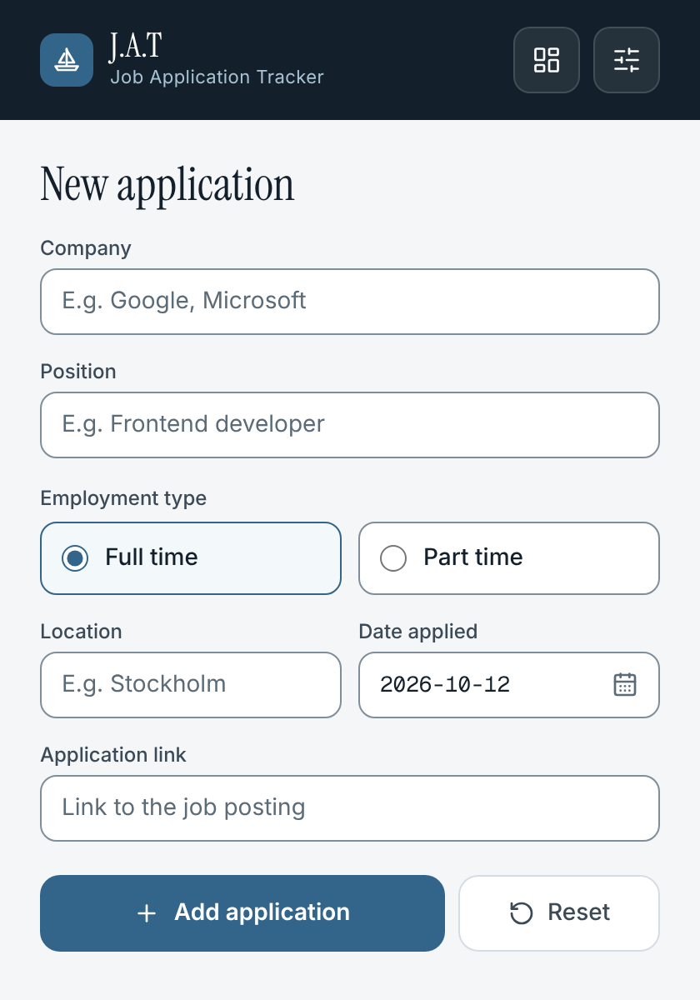

### Overview

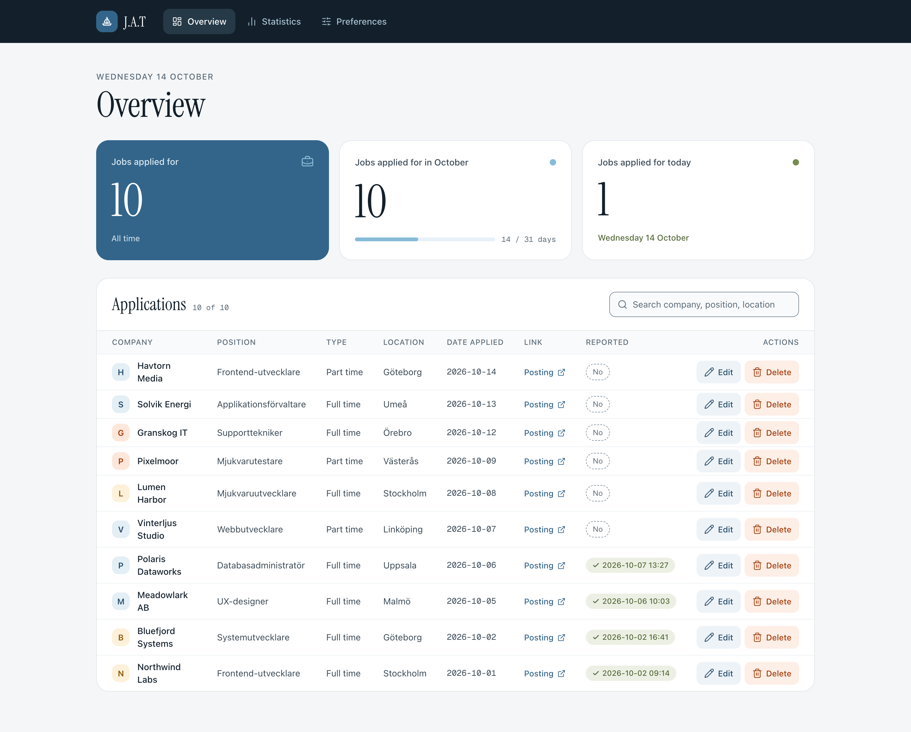

### Reporting to Arbetsförmedlingen

On a wide window the panel sits to the right of the form and lists the applications from the reported month.

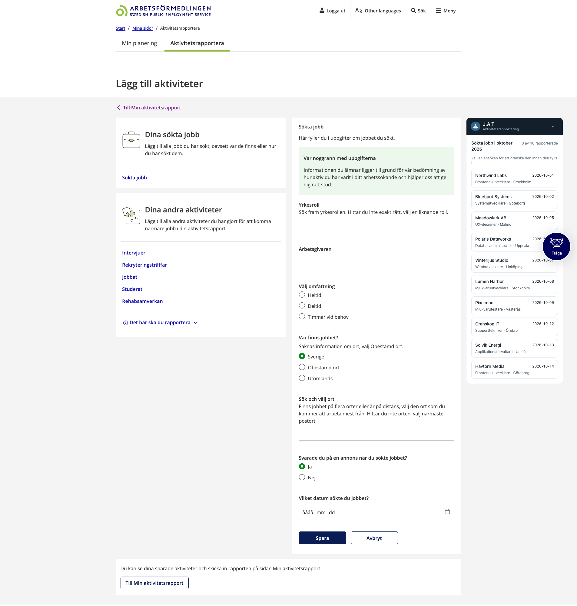

On a narrower window the panel sits inside the form section and starts collapsed.

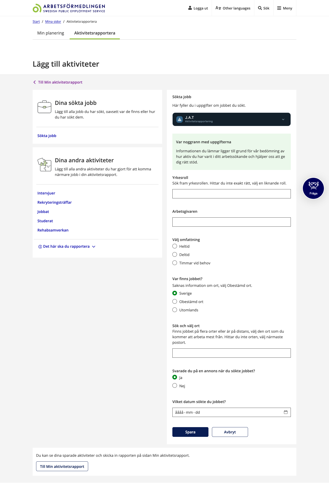

Picking an application shows a preview of what will be filled in.

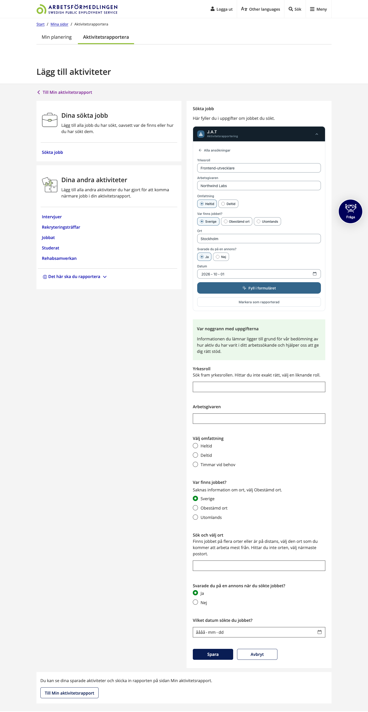

After filling, the panel shows each field's result and the form is ready to be saved.

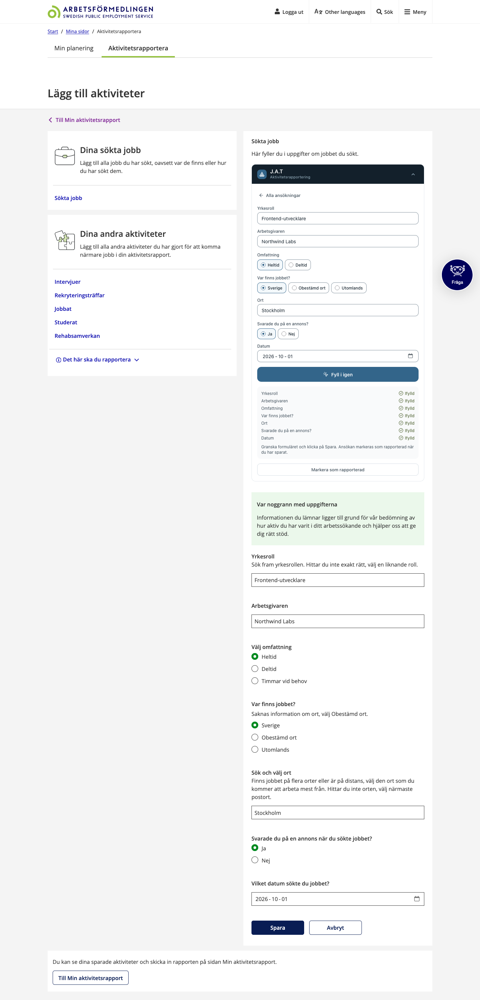

### Statistics

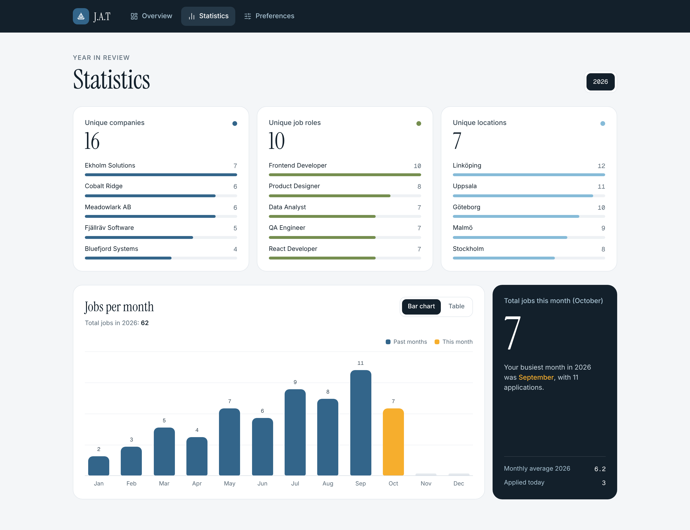

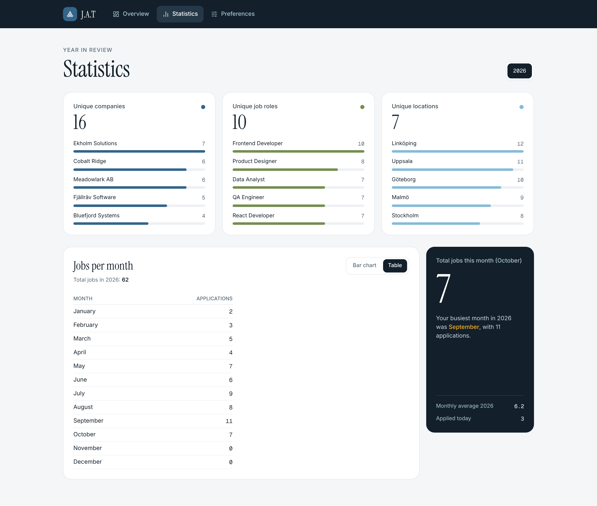

### Preferences

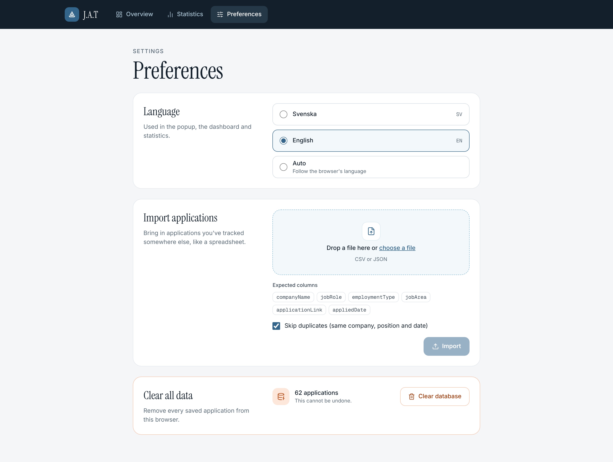

### Dialogs

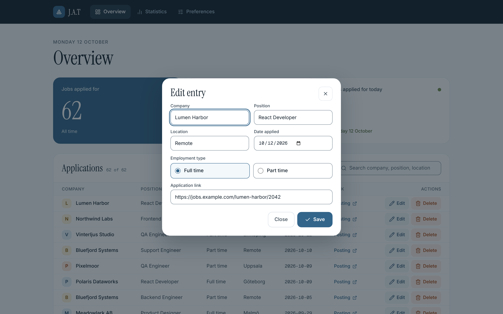

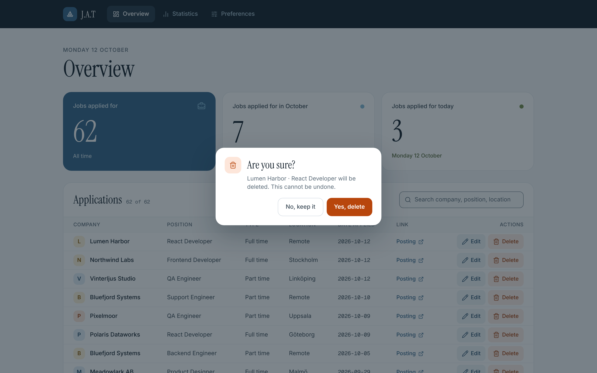

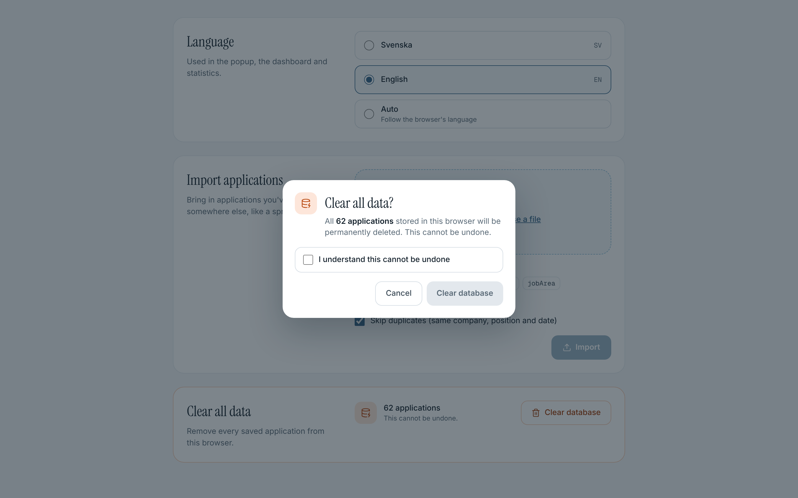

Screenshots of earlier versions are kept in [screenshots/archive](screenshots/archive).
